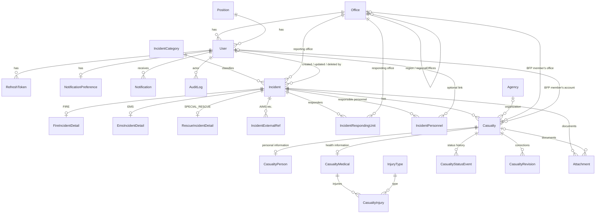

# BFP-CMS Data Model

PostgreSQL through Prisma 7.

- The schema is split: `backend/prisma/schema.prisma` holds the generator and datasource, and `backend/prisma/models/**/*.prisma` holds the models.
- The client is generated into `backend/src/generated/prisma/`.
- Migrations are in `backend/prisma/migrations/`.

The business rules are in [REQUIREMENTS.md](REQUIREMENTS.md), and the way the code uses these tables is in [ARCHITECTURE.md](ARCHITECTURE.md).

The schema below is the full BFP-CMS baseline. As of roadmap Phase 1 the code uses the organization, user and audit tables. The incident, casualty, reference, attachment and notification-event tables exist but get their modules in Phases 2–5.

## 1. Entity relationships

`IncidentNumberCounter` (table `incident_number_counters`) stands alone. `AuditLog` references only its actor; its `officeId`, `regionId` and `entityId` are plain snapshot ids.

## 2. Organization and users

| Model | Key fields | Constraints |
|---|---|---|
| `Office` | `name`, `type: OfficeType`, `isActive`, `parentId?`, `regionId?`, `regionCode?` | `@@unique([parentId, name])`; `regionCode` unique; indexes on `parentId`, `regionId`, `type` |
| `User` | `email`, `account_number`, `rank: RANK`, names, `password` (bcrypt hash), `isActive`, `mustChangePassword`, `failedLoginCount`, `lockedUntil`, `officeId`, `positionId`, `role: UserRole`, `section: Section?`, `sectionDesignationRef?` | `email` and `account_number` unique; indexes on `officeId`, `positionId`, `role`, `section` |
| `Position` | `name`, `isActive` | `name` unique |
| `RefreshToken` | `refreshToken` (SHA-256 hash), `expiresAt`, `userId` | unique; cascade on user delete |
| `NotificationPreference` | `casualtyAlerts`, `recordCorrections`, `systemAnnouncements` (all default on) | one per user; cascade |
| `Notification` | `userId`, `type`, `title`, `body`, `entityType`, `entityId`, `readAt?`, `createdAt` | cascade with the user; index `(userId, readAt, createdAt)` |

- The office structure is unchanged from FIIS.
  - `parent`/`children` is the hierarchy.
  - `region`/`regionalOffices` points every office below regional level at its regional office.
  - Only regional offices carry a `regionCode`.
- A user's tier is the tier of their office's `type`.
- `section` is required for `ENCODER` and station `VIEWER` accounts and refused for `ADMIN` and `SUPER_ADMIN`. The service enforces this; the database does not.
- `password` never leaves the API.

## 3. Reference data

| Model | Key fields | Notes |
|---|---|---|
| `IncidentCategory` | `responseType`, `name`, `isActive` | `@@unique([responseType, name])`. Seeded for FIRE (Structural, Non-structural, Transportation, Wildland), EMS, and SPECIAL_RESCUE (HAZMAT, CSSR, other). Deactivated rather than deleted |
| `Agency` | `name`, `affiliation` (`OTHER_GOVERNMENT` / `OTHER_LAW_ENFORCEMENT`), `isActive` | `name` unique |
| `InjuryType` | `name`, `isActive` | `name` unique |

## 4. Incidents

| Model | Key fields | Notes |
|---|---|---|
| `Incident` | `incidentNo`, `responseType`, `categoryId`, `reportingOfficeId`, `occurredAt?`, `reportedAt?`, `placeOfOccurrence`, `barangay`, `cityMunicipality`, `provinceDistrict`, `region`, `latitude?`, `longitude?` (`Decimal(9,6)`), `narrative?`, `extra Json?`, `lastCasualtySeq`, `createdById`, `updatedById?`, `deletedAt?`, `deletedById?`, `deletionReason?` | `incidentNo` unique. Indexes on `reportingOfficeId`, `(responseType, occurredAt)`, `occurredAt`, `categoryId`, `deletedAt`. The location's region, province/district and city/municipality are derived from the office |
| `FireIncidentDetail` | `highestAlarmLevel?`, `finalStatus?`, `structuresAffected?` | 1:1, cascade |
| `EmsIncidentDetail` | `natureOfCall?` | 1:1, cascade |
| `RescueIncidentDetail` | `hazardClass?`, `personsRescued?` | 1:1, cascade |
| `IncidentExternalRef` | `sourceSystem` (`AIMS`, `OTHER`), `externalId`, `url?` | `@@unique([sourceSystem, externalId])`: an AIMS incident is entered once |
| `IncidentRespondingUnit` | `officeId`, `unitDesignation?`, `isLead`, `arrivedAt?` | linked to the incident, never to casualties |
| `IncidentPersonnel` | `role: IncidentPersonnelRole`, `fullName`, `rank?`, `userId?` | |
| `IncidentNumberCounter` | `year`, `month`, `regionCode`, `responseType`, `lastNumber` | `@@unique([year, month, regionCode, responseType])` |

## 5. Casualties

| Model | Key fields | Notes |
|---|---|---|
| `Casualty` | `casualtyNo` (`<incidentNo>-C<NN>`), `incidentId`, `affiliation`, `agencyId?`, `bfpOfficeId?`, `bfpUserId?`, `bfpRank?`, `currentStatus`, `severity?`, `activityAtTime?`, `isIdentified`, `isComplete`, `extra Json?`, created/updated/deleted by and at, `deletionReason?`, `anonymizedAt?` | Classification only. Statistics read this table. Indexes on `incidentId`, `affiliation`, `currentStatus`, `createdAt`, `deletedAt` |
| `CasualtyPerson` | names, `dateOfBirth?` (date), `ageYears?`, `ageIsEstimated`, `sex?`, `nationality?`, address fields, `contactNumberEnc?` | Personal information. 1:1, cascade. Blanked by the retention job |
| `CasualtyMedical` | `bodyParts?`, `treatment?`, `receivingFacility?`, `transportedBy?`, `dateOfDeath?`, `placeOfDeath?`, `causeOfDeathNoteEnc?` | Sensitive personal information (health). 1:1, cascade |
| `CasualtyInjury` | `medicalId`, `injuryTypeId` | composite primary key |
| `CasualtyStatusEvent` | `fromStatus?`, `toStatus`, `occurredAt`, `remarks?`, `createdById` | Status history. Index `(casualtyId, occurredAt)` |
| `CasualtyRevision` | `revisionNo`, `reason`, `changedFields Json`, `createdById` | Corrections, with field names only. `@@unique([casualtyId, revisionNo])` |

`*Enc` columns hold AES-256-GCM ciphertext. The encryption helper comes with the casualty module in Phase 3.

## 6. Attachments and audit

| Model | Key fields | Notes |
|---|---|---|
| `Attachment` | `incidentId`, `casualtyId?`, `isSensitive`, `uploadedById`, `originalName`, `mimeType` (detected from content), `sizeBytes`, `storageKey` (unique, never returned), `sha256`, `description?`, `createdAt`, `removedAt?`, `removedById?` | Cascades with its incident or casualty; soft removal |
| `AuditLog` | `actorId`, `action: AuditAction`, `entityType: AuditEntityType`, `entityId`, `officeId?`, `regionId?`, `changes Json?`, `createdAt` | Written in the same transaction as the change; append-only. `changes` never holds passwords, tokens, or casualty personal or health values. Indexes on `(entityType, entityId)`, `actorId`, `createdAt`, `officeId`, `regionId` |

## 7. Enums

| Enum | Values |
|---|---|
| `OfficeType` | `NATIONAL_HEADQUARTERS`, `REGIONAL_OFFICE`, `DISTRICT_FIRE_STATION`, `PROVINCIAL_FIRE_STATION`, `CITY_FIRE_STATION`, `MUNICIPAL_FIRE_STATION` |
| `UserRole` | `SUPER_ADMIN`, `ADMIN`, `ENCODER`, `VIEWER` |
| `Section` | `OPERATIONS`, `EMS`, `SRF` |
| `RANK` | `FDIR` … `FO1` |
| `ResponseType` | `FIRE`, `EMS`, `SPECIAL_RESCUE` |
| `FireAlarmLevel` | `FIRST_ALARM` … `FIFTH_ALARM`, `TASK_FORCE_ALPHA` … `TASK_FORCE_DELTA`, `GENERAL_ALARM` |
| `FireIncidentStatus` | `VERIFICATION`, `ON_GOING`, `FIRE_UNDER_CONTROL`, `FIRE_OUT`, `FIRE_OUT_UPON_ARRIVAL`, `FALSE_ALARM`, `REKINDLE` (final status of a fire) |
| `ExternalSourceSystem` | `AIMS`, `OTHER` |
| `IncidentPersonnelRole` | `GROUND_COMMANDER`, `TEAM_LEADER`, `REPORTING_OFFICER`, `OTHER` |
| `Affiliation` | `CIVILIAN`, `BFP_PERSONNEL`, `FIRE_AIDE`, `BFP_VOLUNTEER`, `OTHER_GOVERNMENT`, `OTHER_LAW_ENFORCEMENT`, `OTHER_UNCLASSIFIED` |
| `CasualtyStatus` | `INJURED`, `DECEASED` |
| `CasualtySeverity` | `MINOR`, `SERIOUS`, `CRITICAL` |
| `CasualtyActivity` | `SUPPRESSION`, `RESCUE`, `EMS_CARE`, `TRANSPORT`, `OTHER` |
| `Sex` | `MALE`, `FEMALE`, `UNKNOWN` |
| `TreatmentType` | `ON_SITE`, `TRANSPORTED`, `REFUSED`, `NONE` |
| `PlaceOfDeath` | `ON_SCENE`, `IN_TRANSIT`, `HOSPITAL` |
| `AuditAction` | `USER_CREATED`, `USER_UPDATED`, `USER_ACTIVATED`, `USER_DEACTIVATED`, `USER_PASSWORD_CHANGED`, `USER_PASSWORD_RESET`, `OFFICE_*`, `POSITION_*`, `REFERENCE_CREATED/UPDATED`, `INCIDENT_CREATED/UPDATED/DELETED/RESTORED`, `CASUALTY_CREATED/UPDATED/STATUS_CHANGED/DELETED/RESTORED`, `CASUALTY_PII_VIEWED`, `REPORT_EXPORTED`, `ATTACHMENT_DOWNLOADED` |
| `AuditEntityType` | `USER`, `OFFICE`, `POSITION`, `INCIDENT_CATEGORY`, `AGENCY`, `INJURY_TYPE`, `INCIDENT`, `CASUALTY`, `REPORT`, `ATTACHMENT` |
| `NotificationType` | `BFP_PERSONNEL_CASUALTY`, `CASUALTY_DECEASED`, `RECORD_CORRECTED` |
| `NotificationEntityType` | `INCIDENT`, `CASUALTY` |

## 8. Migrations

| Migration | Change |
|---|---|
| `20261125000000_bfp_cms_init` | BFP-CMS baseline: the whole schema above. It replaces the FIIS migration history, which remains in git (commit `936a920` and earlier). Databases created with the FIIS migrations must be reset before applying it (REQUIREMENTS.md §11) |

Create migrations with `npx prisma migrate dev --name <name> --config prisma7.config.ts` and regenerate with `npx prisma generate --config prisma7.config.ts`. Seed reference data with `npm run seed`, which is idempotent.
